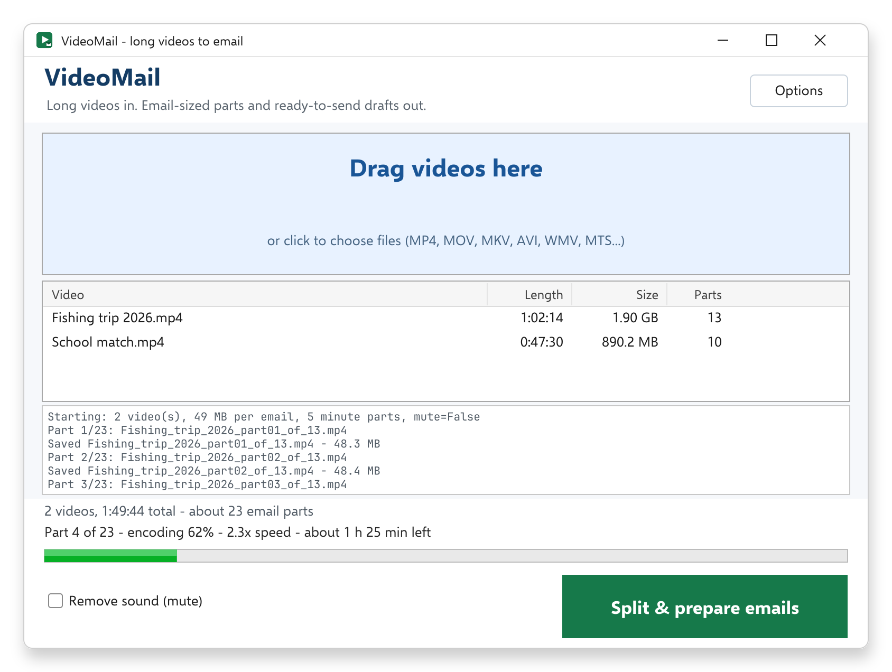
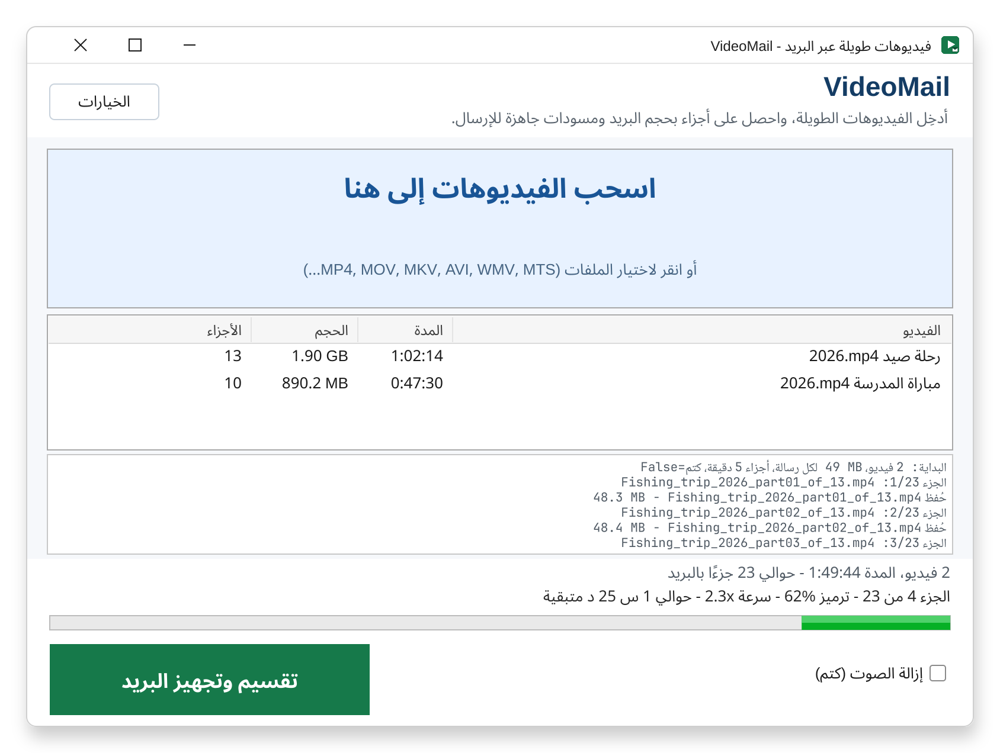
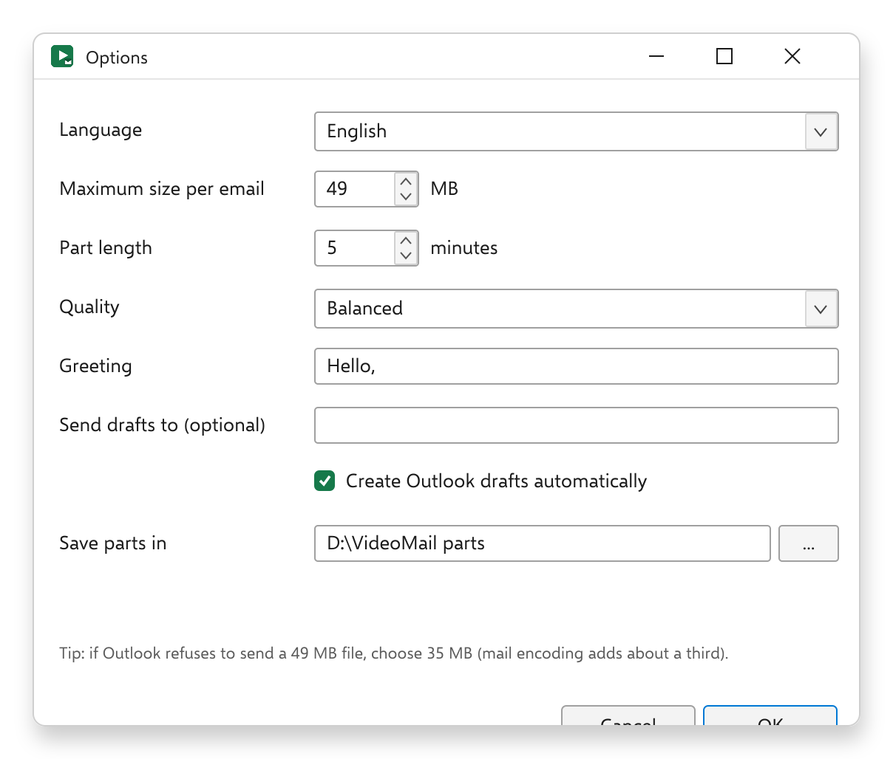

# VideoMail

**Long videos in. Email-sized parts and ready-to-send Outlook drafts out.**

VideoMail is a small portable Windows app for sending a long video by email.
Drop a video on the window, press one button, and it produces numbered
5-minute MP4 parts that fit under your mail size limit — plus Outlook drafts
with the parts already attached and the message already written.

No installer. No admin rights. No upload. Everything runs on the PC.



## Why

Mail providers usually stop at 25–50 MB. A one-hour phone video is several
gigabytes. VideoMail does the boring part: cut, re-encode, name, number,
check the size, and prepare the emails.

## Features

- **One button.** Drag videos (or a folder) onto the window, press
  **Split & prepare emails**.
- **Eight languages.** English, Français, Deutsch, Italiano, Ελληνικά,
  العربية, فارسی and עברית. The app opens in the language Windows uses,
  and once you pick a language in Options it stays chosen. Arabic, Farsi
  and Hebrew get a fully right-to-left window.
- **Fits the limit.** Every part is encoded to stay under the configured
  size (49 MB by default, decimal megabytes).
- **Numbered parts.** `Fishing_trip_part01_of_12.mp4`, zero-padded so the
  order is obvious on disk and in the mail.
- **Outlook drafts.** One draft per email, with greeting, part list and
  attachments. Open Outlook and press Send.
- **Works without Outlook.** No classic Outlook, or "new Outlook"? It writes
  ready-to-forward `.eml` files instead.
- **Mute option.** Tick *Remove sound (mute)* for silent parts.
- **Portable.** Copy the folder to a USB stick. Nothing is installed and no
  registry entries are written.
- **Readable output.** H.264 + AAC MP4, automatically sized for the bitrate
  budget (usually 720p), plays on phones, TVs and PCs.

## Quick start

1. Download `VideoMail-1.1-win64.zip` from
   [Releases](../../releases/latest).
2. Unzip it anywhere — the desktop, a USB stick, a folder.
3. Double-click **VideoMail.exe**.
4. Drag one or more videos onto the blue box.
5. Press **Split & prepare emails**.
6. Wait. VideoMail uses the PC's graphics chip (NVIDIA, AMD or Intel) when
   it can, which makes a one-hour video take roughly 5–15 minutes; on the
   processor alone it is roughly 15–40 minutes. Cancel at any time: finished
   parts are kept, and pressing the button again continues where it stopped.
7. Open **Outlook → Drafts**, check the message, press **Send**.

The parts are saved in a **VideoMail parts** folder next to the original
video. You can change that under **Options**.



> Windows may show *"Windows protected your PC"* the first time because the
> app is not code-signed. Click **More info → Run anyway**.

## Languages

English, French, German, Italian, Greek, Arabic, Farsi and Hebrew. The first
start follows the Windows display language; after you choose one in Options
it is remembered (a one-line `VideoMail.settings.txt` next to the program, or
`%APPDATA%\VideoMail` when the folder is read-only). The window, messages,
logs and the email drafts are all translated, and Arabic, Farsi and Hebrew
flip the interface right-to-left. Output file names stay in Latin letters so
they open cleanly everywhere.

## How it works

Each part is encoded independently to H.264. The bitrate is calculated from
the size limit and the part length, with 2% headroom for container overhead.
If the budget is too low for the source resolution, the video is scaled down
(typically to 720p at 49 MB / 5 min), and anything above 30 fps is reduced to
30 fps. A tiny final part (under 5 seconds) is merged into the previous one.

- **Encoder.** The PC's graphics chip (NVIDIA NVENC, Intel Quick Sync or
  AMD AMF) when one works, tested on one second of the real video;
  otherwise x264 on the processor in one pass. *Best quality* uses two-pass
  x264. A part that comes out too large is encoded again at a lower bitrate.
- **HDR** phone videos are tone-mapped to normal colours.
- **Audio** is AAC at 96 kbps stereo (64 kbps mono). Mute removes the audio
  track completely.
- **Cancel and continue.** Finished parts are kept and recorded (by a
  settings fingerprint) in a hidden `.videomail-parts.txt`; the next run into
  the same folder skips them, unless the settings changed.

The full details, including what is inside `ffmpeg.exe` and why, are in
[docs/how-it-is-built.md](docs/how-it-is-built.md).

## Options

| Setting | Default | Notes |
|---|---|---|
| Language | the Windows language | Eight choices; remembered once you pick one. |
| Maximum size per email | 49 MB | Lower it to 35 MB if your mail server rejects large messages. |
| Part length | 5 minutes | 1–30 minutes. |
| Quality | Balanced | Balanced and Fastest use the graphics chip when it works, otherwise one processor pass. Best quality always does two processor passes (slowest, most quality per MB). |
| Greeting | `Hello,` | First line of every draft. |
| Send drafts to | empty | Optional; fills the To line. |
| Save parts in | next to the source | Any folder. |
| Create Outlook drafts | on | Untick to only produce the MP4 files. |



Use **35 MB** if sending fails. Mail encoding (Base64) makes a 49 MB file
about 65 MB on the wire, and some providers count that instead of the file
size.

## Outlook

- **Classic Outlook for Windows** is needed for automatic drafts. VideoMail
  uses Outlook's COM interface and saves each message in Drafts; the sender
  account is whatever Outlook is already using.
- **New Outlook, Outlook on the web, or no Outlook:** VideoMail writes
  `.eml` files into `Email drafts - open and forward`. Open one, click
  **Forward**, add the recipient, and send.
- Large attachments also use space in Outlook's local data file.

## Supported input

**Containers:** MP4, MOV, M4V, MKV, WebM, AVI, WMV, ASF, FLV, F4V, TS, MTS,
M2TS, MPG, MPEG, VOB, MOD, TOD, 3GP, DV, OGV, MXF.

**Video:** H.264, HEVC, AV1, VP8/VP9, MPEG-2, MPEG-4 (DivX/Xvid), H.263,
Sorenson FLV, DV, WMV/VC-1, ProRes, DNxHD, MJPEG, Theora.

**Audio:** AAC, MP3, MP2, AC3/E-AC3, DTS, TrueHD, FLAC, ALAC, Opus, Vorbis,
WMA/WMA Pro, AMR, PCM, ADPCM.

**Phone videos:** iPhone and Android (Samsung, Pixel, ...) recordings work
as they are, including portrait and rotated clips, 60/120 fps, 4K/8K, and
HDR (HLG, HDR10/HDR10+, Dolby Vision 8.4), which is tone-mapped to normal
SDR colours so it plays correctly everywhere.

## Verify a download

Official zips are built by GitHub Actions from a tagged commit of this
repository, inside a pinned container, never on a personal computer. The
only programs in the zip are `ffmpeg.exe` (with its `libwinpthread-1.dll`)
and the small `VideoMail.exe` launcher (source: `assets/launcher.c`);
everything else is readable text.

Three ways to check a zip, quickest first:

1. **Checksum.** Compare its SHA-256 with the one on the release page.
   On Windows: `Get-FileHash .\VideoMail-1.1-win64.zip` in PowerShell.
2. **Build provenance.** With the GitHub CLI:
   `gh attestation verify VideoMail-1.1-win64.zip --repo pixeljon/videom`.
   This proves the exact file came from this repository's release
   workflow, and shows the commit it was built from.
3. **Rebuild it yourself.** The build is reproducible: the same tag gives a
   byte-identical zip. It needs Docker and takes about 10 minutes:

   ```bash
   git clone https://github.com/pixeljon/videom.git && cd videom
   git checkout v1.1
   docker build -t videomail-build build
   docker run --rm --user "$(id -u):$(id -g)" \
     -v "$PWD:/src:ro" -v "$PWD/out:/out" videomail-build
   sha256sum out/VideoMail-1.1-win64.zip   # must equal the release's hash
   ```

What is pinned: the Debian base image by digest and its compiler packages
by snapshot.debian.org date (`build/Dockerfile`), every source tarball by
SHA-256 and every git source by commit (`build/reproducible-build.sh`).
A source that does not match its pin stops the build.

## Build from source

The easiest way is the container in "Verify a download" above; it is how
releases are made. To build without Docker, cross-compile on Linux with
mingw-w64; the result works the same but is not byte-identical to a release.

Requirements: `mingw-w64` (gcc and g++), `nasm`, `make`, `pkg-config`,
`meson`, `cmake`, `ninja`, `zip`, and PowerShell 7 (`pwsh`) for the self-test.

```bash
# Sources (versions used for the release)
mkdir -p .build/src && cd .build/src
curl -LO https://ffmpeg.org/releases/ffmpeg-9.0.2.tar.xz
tar xf ffmpeg-9.0.2.tar.xz
git clone https://code.videolan.org/videolan/x264.git
git -C x264 checkout 0480cb05fa188d37ae87e8f4fd8f1aea3711f7ee
curl -LO https://downloads.videolan.org/pub/videolan/dav1d/1.5.1/dav1d-1.5.1.tar.xz
tar xf dav1d-1.5.1.tar.xz
git clone --depth 1 --branch n11.1.5.3 https://git.videolan.org/git/ffmpeg/nv-codec-headers.git
curl -LO https://github.com/GPUOpen-LibrariesAndSDKs/AMF/releases/download/v1.5.3/AMF-headers-v1.5.3.tar.gz
mkdir -p amf && tar xf AMF-headers-v1.5.3.tar.gz -C amf
curl -L -o libvpl-2.17.0.tar.gz https://github.com/intel/libvpl/archive/refs/tags/v2.17.0.tar.gz
tar xf libvpl-2.17.0.tar.gz
cd ../..

# Build ffmpeg.exe (minimal, static, with x264, dav1d and GPU encoders)
TC=/usr bash build/build-windows.sh

# Assemble the portable folder and zip
bash build/package.sh
```

`build/build-windows.sh` also works with a custom mingw toolchain in
`.build/tc`; point `TC` at its root. The resulting binary is stripped and
contains no build-machine paths.

`VideoMail.ps1` is generated by concatenating `src/01-core.ps1`,
`src/02-strings.ps1`, `src/03-encode.ps1`, `src/04-gui.ps1` and
`src/05-main.ps1`; `package.sh` does this and runs the built-in self-test.

## Project layout

```
VideoMail.ps1        generated single-file app
src/                 app sources, split by area
assets/              icon, version info, launcher source
build/               Windows build, packaging, and the pinned release container
.github/workflows/   self-test on every push; release build on version tags
docs/                interface previews; how-it-is-built.md (build and verification)
README.txt           the readme shipped inside the zip
LICENSES.txt         third-party licenses
```

## Privacy

VideoMail reads the selected videos, writes the parts to the output folder,
and writes a log to `%TEMP%\VideoMail.log`. If you change the language, it
saves that single choice in a small text file next to the program (or in
`%APPDATA%\VideoMail` if the program folder is read-only). It does not use
the network. Nothing is uploaded.

## License

The VideoMail scripts and launcher are MIT licensed; see [LICENSE](LICENSE).
`ffmpeg.exe` is GPLv2+ because it includes x264. See
[LICENSES.txt](LICENSES.txt) and [COPYING.GPLv2.txt](COPYING.GPLv2.txt) for
the bundled components and source locations.

---

*The interface images above are layout previews rendered from the UI code.
Windows may render fonts and controls slightly differently.*
